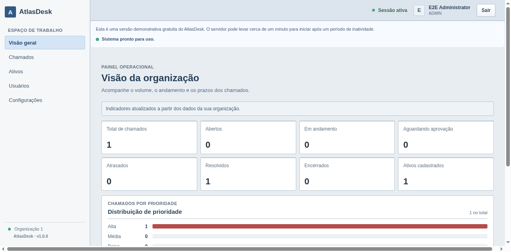
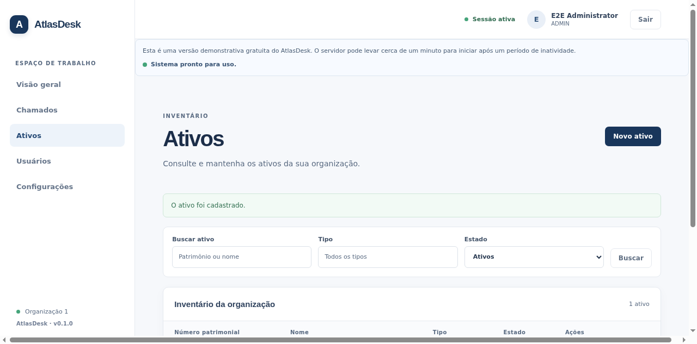
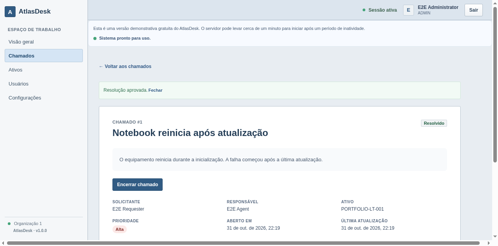
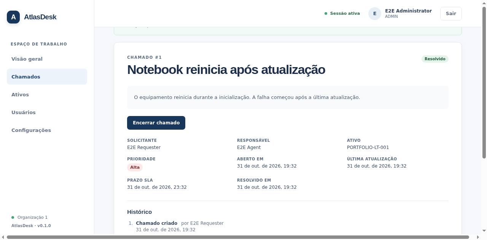
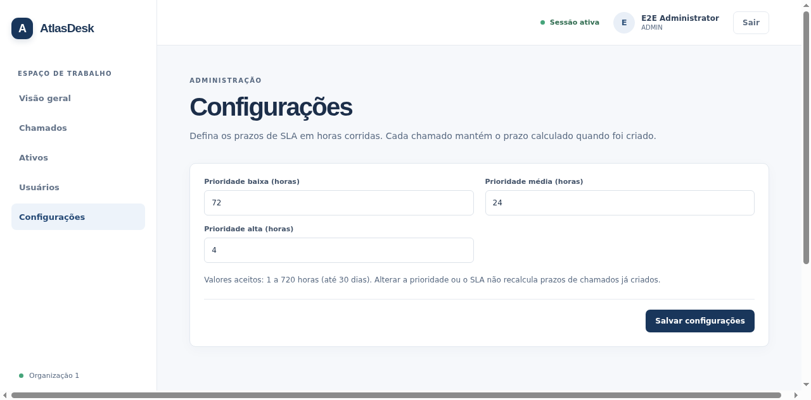
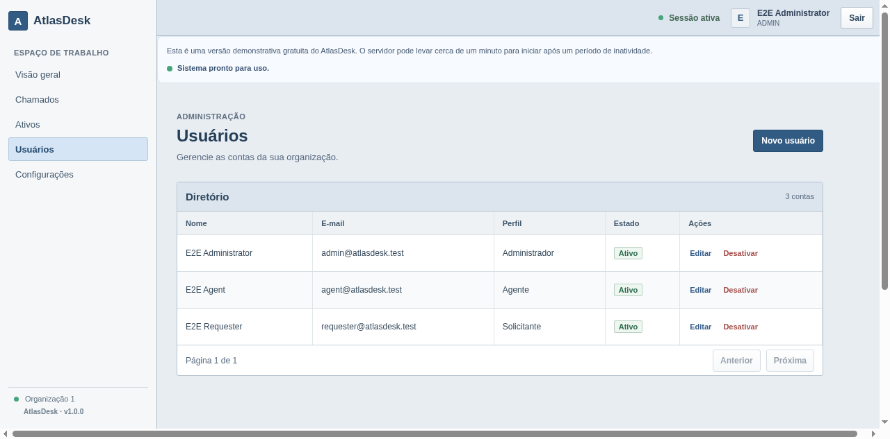

# AtlasDesk

AtlasDesk is a multi-tenant IT service desk for tracking support tickets, technology assets, service-level deadlines, and resolution approvals. It is a portfolio and development project designed to run locally with Docker Compose.

## Product tour

The current application includes:

- Organization-scoped login, session restoration, logout, and role-aware navigation.
- A dashboard with ticket counts, priority distribution, overdue counts, and active asset totals.
- Ticket creation, search and filters, assignment, status transitions, optional resolution approval, and an event timeline.
- An asset directory with organization-scoped create, update, activation, and search.
- ADMIN user management and per-organization SLA settings.
- Backend authorization and data queries scoped to the organization in the authenticated session.

### Real application screenshots

These images are captured from the running application by the Cypress browser using the isolated E2E database and its synthetic demo accounts. Run the E2E suite to refresh them.

| Dashboard | Asset inventory |
| --- | --- |
|  |  |

| Ticket workflow | Ticket event history |
| --- | --- |
|  |  |

| Organization settings | User administration |
| --- | --- |
|  |  |

### Walkthrough

1. Sign in with the isolated E2E ADMIN account and review the organization dashboard.
2. Add an asset from **Ativos**. ADMIN and AGENT can maintain assets; REQUESTER can select active assets when opening a ticket.
3. Sign in as REQUESTER, open a high-priority ticket, and optionally associate the asset. Its `dueAt` deadline is calculated using the organization SLA at creation time.
4. Sign in as AGENT, assign the ticket to yourself, start the work, and request resolution. When approval is enabled, the ticket moves to `PENDING_APPROVAL`.
5. Sign in as ADMIN, approve or reject the request, and inspect the ticket event timeline. A requester can close a resolved ticket.
6. Review **Configurações** and **Usuários** as ADMIN. SLA changes apply to new tickets and do not rewrite existing deadlines.

The screenshots and Cypress seed data are illustrative test data, not customer records.

## Roles and access

All organization-owned records are queried and changed using the organization ID from the authenticated session. A client-supplied ID does not grant cross-organization access. See [the permission matrix](docs/permissions.md).

| Capability | ADMIN | AGENT | REQUESTER |
| --- | --- | --- | --- |
| Dashboard | All tickets in own organization | All tickets in own organization | Own tickets; active asset count for organization |
| Tickets | Read/create; assign; administer transitions | Read/create; assign; transition when assigned | Read own; create; close own resolved tickets |
| Ticket history | Same visibility as ticket | Same visibility as ticket | Own tickets only |
| Assets | Read/create/update/activate | Read/create/update/activate | Read active assets with limited details |
| Users | Manage users in own organization | No user directory access | Own profile only |
| SLA settings | Read/update | Read | Read |

## Architecture and stack

AtlasDesk is a modular monolith with a REST API and a React single-page application. The backend is the authority for validation, authorization, tenant scoping, workflow transitions, and SLA calculation. The browser uses same-site HttpOnly session cookies and CSRF protection. PostgreSQL schema changes are versioned with Flyway; JPA validates the resulting schema.

| Area | Technologies |
| --- | --- |
| API | Java 21, Spring Boot 3.5, Spring MVC, Spring Security, Spring Data JPA, Maven, JUnit 5 |
| Web | React 18.3.1, TypeScript strict mode, Vite, React Router 7, Fetch API, native CSS |
| Data | PostgreSQL 16, Flyway |
| Browser tests | Cypress 15, Chrome, TypeScript |
| Development and CI | Docker Compose, Jenkins Declarative Pipeline |

### Repository layout

```text
backend/src/main/java/com/adria/atlasdesk/  API domains and security
backend/src/main/resources/db/migration/   Flyway migrations V1–V6
backend/src/test/java/                     JUnit and Spring integration tests
frontend/src/                              React application and styles
tests/e2e/cypress/e2e/                     Cypress browser workflows
tests/e2e/cypress/fixtures/                 Synthetic E2E account data
docs/                                      Permissions, decisions, screenshots
compose.yml                                Development and E2E services
Jenkinsfile                                Root Declarative Pipeline
AGENTS.md                                  Repository engineering instructions
```

## Prerequisites

- Git
- Docker Desktop or Docker Engine with Docker Compose v2

Java, Maven, Node.js, npm, PostgreSQL, Chrome, and Cypress run inside Docker containers. Do not install the application stack on the host.

## Start from a fresh clone

The repository is private. Clone it with an account that has access, then run these commands from the repository root:

```powershell
Copy-Item .env.example .env
# Optional: edit .env and set DEV_ADMIN_PASSWORD to a local-only password.
docker compose --profile e2e config --quiet
docker compose up -d --build --wait db backend frontend
docker compose ps
```

Open <http://localhost:5173>. The backend health endpoint is <http://localhost:8080/api/health>. The API container applies Flyway migrations before becoming healthy. PostgreSQL is available to host tools on port `5432` for local administration; application services communicate using Compose service names such as `db` and `backend`.

If another local project uses one of these host ports, change `POSTGRES_PORT`, `BACKEND_HOST_PORT`, or `FRONTEND_HOST_PORT` in `.env`; the service ports and internal Docker addresses stay the same.

The checked-in `.env.example` contains synthetic local database settings and leaves `DEV_ADMIN_PASSWORD` empty. To create a local-only ADMIN account, set `DEV_ADMIN_PASSWORD` to a password you choose in the ignored `.env` file before starting the backend. The development seeder creates `atlasdesk-admin@localhost.test` only under the `dev` profile. Do not use local or E2E credentials in a deployed environment. Keep `SESSION_COOKIE_SECURE=true` when serving over HTTPS; the example uses `false` for the default local HTTP setup.

With the example database settings, you can look up the seeded organization ID with `docker compose exec db psql -U atlasdesk -d atlasdesk -c "select id, name from organizations;"`. Sign in with that ID, `atlasdesk-admin@localhost.test`, and the password you set in `.env`.

### Demo accounts

The fixed demo identities are created only when the E2E profile resets its isolated database. They do not exist in the normal development or production database.

| Organization ID | Role | Email | Password |
| --- | --- | --- | --- |
| `1` | ADMIN | `admin@atlasdesk.test` | `AtlasE2E!2026` |
| `1` | AGENT | `agent@atlasdesk.test` | `AtlasE2E!2026` |
| `1` | REQUESTER | `requester@atlasdesk.test` | `AtlasE2E!2026` |
| `2` | Other organization ADMIN | `admin@other-atlasdesk.test` | `AtlasE2E!2026` |

These accounts are deliberately synthetic, committed as test fixtures, and safe only for the disposable E2E database. Never copy them into a real environment.

### Local demonstration

The separate `demo` profile seeds two fictional organizations, an ADMIN, AGENT, and REQUESTER in each organization, six assets per organization, and twelve tickets per organization. Stable names, account emails, asset numbers, and ticket titles make the seed idempotent. The seeder creates the ticket states and history through the existing workflow rules. All accounts use a password from the ignored `.env.demo` file.

Create the local settings file, set `DEMO_USER_PASSWORD` to a local-only password of 12–72 UTF-8 bytes, then start the isolated project:

```powershell
Copy-Item .env.demo.example .env.demo
# Edit .env.demo and set DEMO_USER_PASSWORD.
docker compose -p atlasdesk-demo --env-file .env.demo config --quiet
docker compose -p atlasdesk-demo --env-file .env.demo up -d --build --wait db backend frontend
```

The demo logins use organization ID `1` for Atlas Technology and `2` for Nexus Solutions on a new volume. Passwords are not committed. The demo database has its own Compose project and volume; Cypress resets only its isolated E2E database. Stop the demo with `docker compose -p atlasdesk-demo --env-file .env.demo stop` to preserve its data.

### Development commands

Source is bind-mounted for live editing. Vite refreshes frontend changes automatically; restart the backend after Java source changes.

```powershell
docker compose logs -f db backend frontend
docker compose restart backend
docker compose build backend frontend
docker compose down
```

The named PostgreSQL and dependency-cache volumes persist across `docker compose down`. Do not use `docker compose down -v` for routine development.

## Database migrations

Flyway applies migrations on backend startup. Files are under `backend/src/main/resources/db/migration/`:

| Migration | Schema change |
| --- | --- |
| V1 | Organizations and users |
| V2 | Technology assets |
| V3 | Support tickets |
| V4 | Optimistic ticket version for concurrent updates |
| V5 | Organization SLA ranges and defaults |
| V6 | Ticket history events |

Add new schema changes as the next versioned SQL migration; do not edit an already-applied migration. Existing ticket history includes creation events, but previous assignments and status transitions are not reconstructed.

## Validation

Run checks inside Compose containers. The development services must be started first for `exec` commands:

```powershell
docker compose exec backend mvn -B test
docker compose exec backend mvn -B verify
docker compose exec frontend npm run lint
docker compose exec frontend npm run typecheck
docker compose exec frontend npm run format:check
docker compose exec frontend npm run build
```

The full E2E command uses a dedicated database and synthetic accounts; it does not connect to the development database. It also refreshes the portfolio screenshots in `docs/screenshots/`.

```powershell
docker compose --profile e2e run --rm e2e
```

To run only the screenshot walkthrough while iterating on documentation:

```powershell
docker compose --profile e2e run --rm --entrypoint sh e2e -c "npm ci --prefer-offline && npx cypress run --browser chrome --spec cypress/e2e/portfolio-screenshots.cy.ts"
```

See [the E2E guide](tests/e2e/README.md) for Cypress configuration, isolation, typechecking, screenshots, and the Jenkins pipeline.

## Continuous integration

The root `Jenkinsfile` is a Declarative Multibranch Pipeline. Configure a Docker-enabled Linux agent with Docker CLI, Compose v2, and a Docker Engine; the agent does not need Java, Maven, Node.js, npm, PostgreSQL, Chrome, or Cypress installed. Configure the agent label `docker-compose` and enable branch and pull-request discovery for the private `adriatravasso/atlasdesk` repository.

Each build uses a unique Compose project and the isolated E2E database. It validates Compose, compiles and tests the backend, lints/typechecks/builds the frontend, runs Cypress, archives test reports and screenshots, then removes the build containers and network while preserving named volumes. Application containers do not mount the Docker socket.

## Decisions and current limitations

The key implementation decisions and known product limitations are documented in [docs/decisions-and-limitations.md](docs/decisions-and-limitations.md). AtlasDesk does not currently provide email notifications, file attachments, ticket comments, password recovery, or SSO. Deployment configuration and free-tier limits are documented in [docs/deployment.md](docs/deployment.md).

The repository remains private. Do not create a release tag or publish a stable release until the deployed build has passed validation and received explicit release approval.
