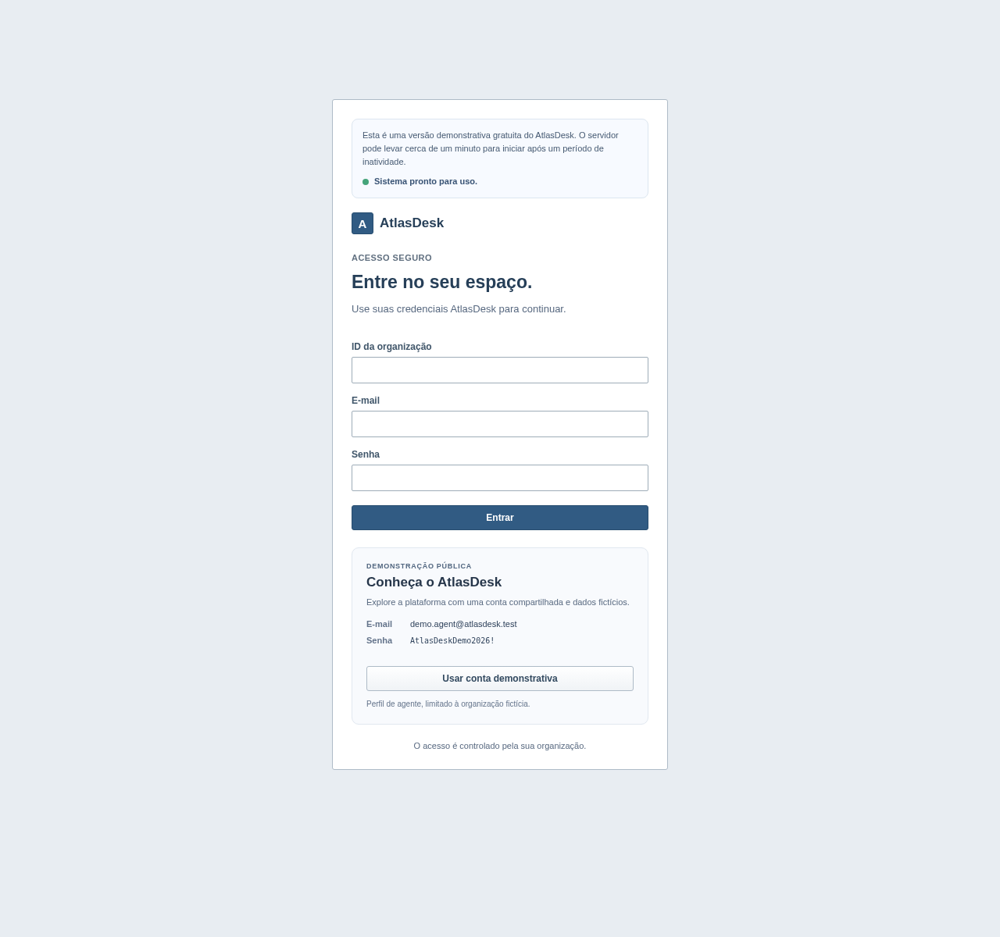
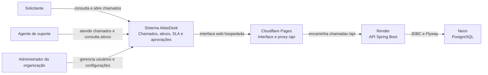
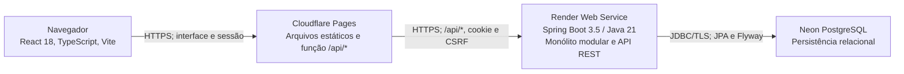
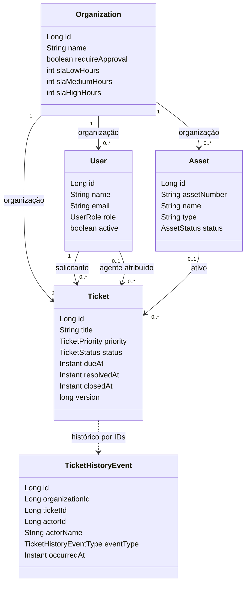

# AtlasDesk

Sistema web de service desk para chamados de TI, inventário de ativos, prazos de SLA e aprovações, com dados isolados por organização.

## Capturas

Capturas reais do frontend executado contra serviços e dados sintéticos no ambiente Cypress isolado.

| Login demonstrativo | Dashboard |
| --- | --- |
|  |  |

| Inventário de ativos | Fluxo de chamados |
| --- | --- |
|  |  |

## Funcionalidades

- Login por organização, sessão HttpOnly, logout e autorização por papel.
- Abertura, busca, atribuição e transição de chamados; histórico, SLA e aprovação de resolução configurável.
- Inventário de ativos com busca, edição e ativação.
- Dashboard com indicadores da organização.
- Administração de usuários e configurações de SLA para `ADMIN`.
- Conta pública demonstrativa com papel `AGENT`, dados sintéticos e acesso limitado à própria organização.

## Stack

Java 21, Spring Boot 3.5, Spring Security, Spring Data JPA, Maven Wrapper, React 18.3.1, TypeScript strict, Vite, React Router 6, PostgreSQL 16, Flyway, JUnit 5, Cypress e Docker Compose.

## Arquitetura

O sistema é um monólito modular com API REST. O backend aplica regras, autorização e isolamento por organização. A sessão autenticada determina o escopo dos dados.

### C4 — Contexto



### C4 — Containers conceituais



### UML de classes



Diagramas completos e estrutura por domínio: [arquitetura](docs/architecture.md) e [modelo de domínio](docs/class-diagram.md).

## Aplicação publicada e conta demo

Frontend: [atlasdesk.pages.dev](https://atlasdesk.pages.dev). API: [verificação de saúde](https://atlasdesk-api.onrender.com/api/health). Frontend Cloudflare Pages, API Render e banco Neon.

Esta branch prepara o seed e o painel da conta demonstrativa. Para o login funcionar no site, o deploy precisa incluir esta versão e as variáveis indicadas em [Deploy e demonstração](docs/deployment.md). A credencial pública planejada é `demo.agent@atlasdesk.test` / `AtlasDeskDemo2026!`; a configuração atual do site ainda precisa ser validada após o deploy.

## Executar localmente

Requisitos no host: Git e Docker Compose v2. Não é preciso instalar Java, Maven, Node.js, npm ou PostgreSQL.

```powershell
Copy-Item .env.example .env
docker compose config --quiet
docker compose up -d --build --wait db backend frontend
```

Abra <http://localhost:5173>. Comandos de validação, seed e execução Cypress: [guia de desenvolvimento](docs/development.md).

## Documentação

- [Desenvolvimento e validação](docs/development.md)
- [Arquitetura](docs/architecture.md)
- [Modelo de domínio](docs/class-diagram.md)
- [Permissões](docs/permissions.md)
- [Deploy e ambiente demonstrativo](docs/deployment.md)
- [Decisões e limitações](docs/decisions-and-limitations.md)
