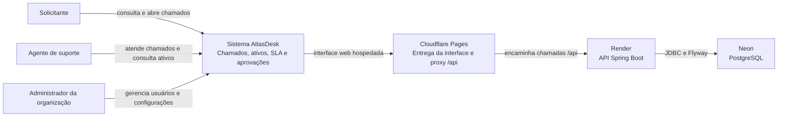
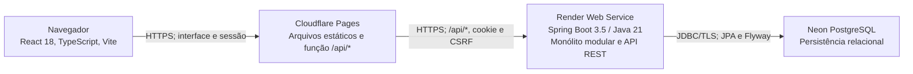

# Arquitetura

O AtlasDesk é um monólito modular com API REST. React entrega a interface; Spring Boot autentica sessões, aplica regras de chamados e escopo por organização; PostgreSQL persiste o domínio. A interface usa cookie de sessão HttpOnly e proteção CSRF. Não há JWT.

## C4 — Contexto

Os provedores fazem parte da implantação atual documentada. O sistema não depende de um serviço de identidade externo; login, sessão e autorização são internos.

## C4 — Containers conceituais

No desenvolvimento, os mesmos componentes executam como serviços Compose `frontend`, `backend` e `db`. Os containers do diagrama C4 são unidades lógicas de execução, não uma descrição das imagens Docker.

## Domínios

- `organization`: organização e configurações de SLA.
- `user` e `security`: usuários, papéis, login, sessão, CSRF e autorização.
- `ticket`: chamados, estados, prioridade, prazos e histórico.
- `asset`: inventário de ativos de TI.
- `dashboard`: indicadores agregados consultados pela interface.

O escopo de tenant vem da sessão autenticada. Repositórios e serviços verificam a organização para cada recurso; IDs enviados pelo navegador não concedem acesso entre organizações. Veja também o [diagrama de classes](class-diagram.md) e a [matriz de permissões](permissions.md).
