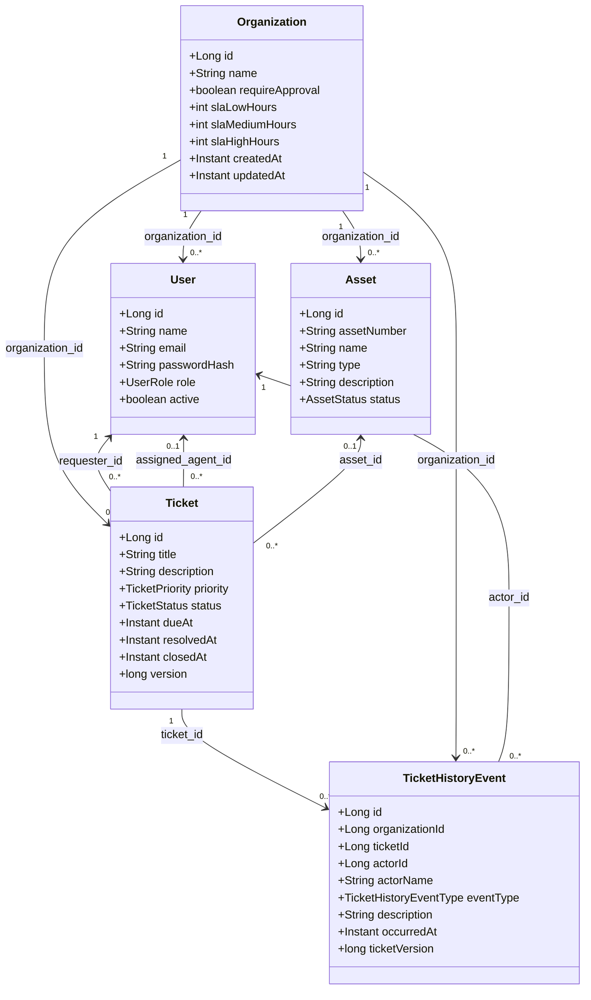
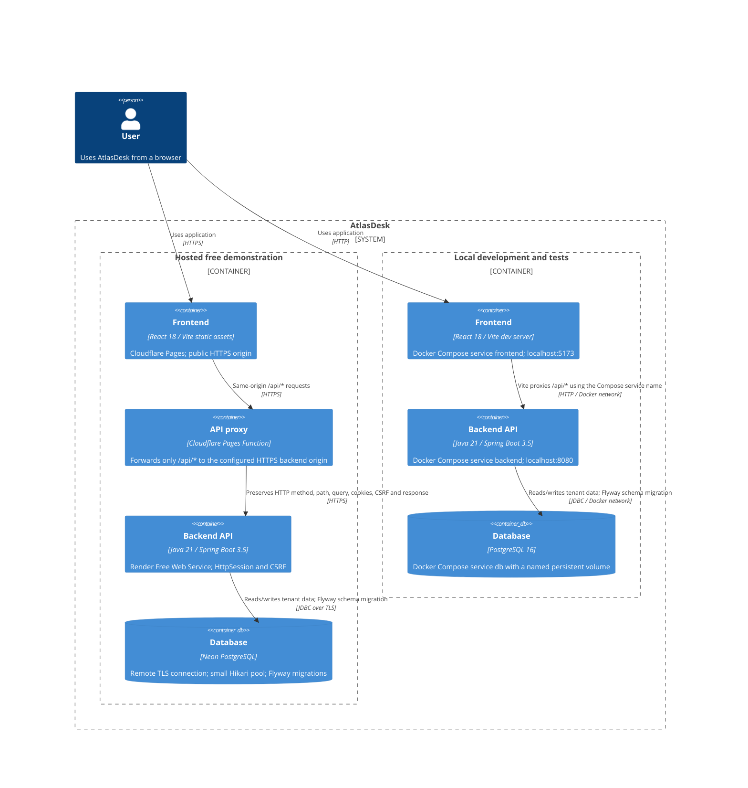

# AtlasDesk architecture

AtlasDesk is a tenant-scoped modular monolith. The React client talks to a Spring REST API; the API owns authentication, authorization, validation, ticket workflows, SLA snapshots, and database access. Flyway applies versioned SQL migrations, and Hibernate validates the schema.

## UML class diagram

The diagram uses the JPA entities and relational foreign keys present in the source and migrations. `OrganizationSettings` is an API value record; the SLA values are columns on `Organization`, so it is not a separate persisted entity. `TicketHistoryEvent` stores foreign-key IDs as scalar fields rather than JPA object relations.

## C4 container diagram

In C4, a container is an application or data store with a responsibility; the term does not mean a Docker container. The same browser workflows can target either of the two deployment arrangements below.

Locally, Compose runs all three application services on a private Docker network, publishes the frontend and API ports for developer access, and persists PostgreSQL and dependency caches in named volumes. In the hosted demonstration, Pages serves the static build and executes the narrow API proxy, Render runs the Java process on its assigned `PORT`, and Neon stores PostgreSQL data remotely. Compose is not a production orchestrator. The hosted backend uses process-local HTTP sessions, so users may have to sign in again after a restart.

See [deployment steps](deployment.md) for the manual provider settings and [decisions and limitations](decisions-and-limitations.md) for current product boundaries.
