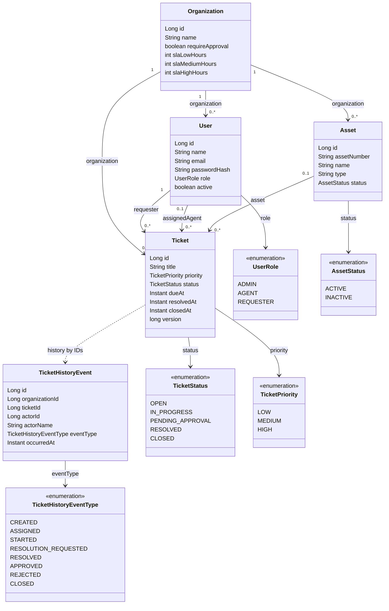

# Modelo de domínio

Diagrama resumido das entidades JPA e associações existentes. `TicketHistoryEvent` registra IDs e um snapshot do nome do ator; não possui associação JPA direta ao chamado.

SLA fica em `Organization` como horas por prioridade; cada `Ticket` guarda `dueAt` como snapshot calculado na criação. Aprovação é representada pelo estado e fluxo do chamado, não por uma entidade separada.
